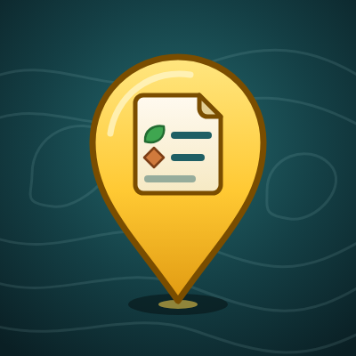
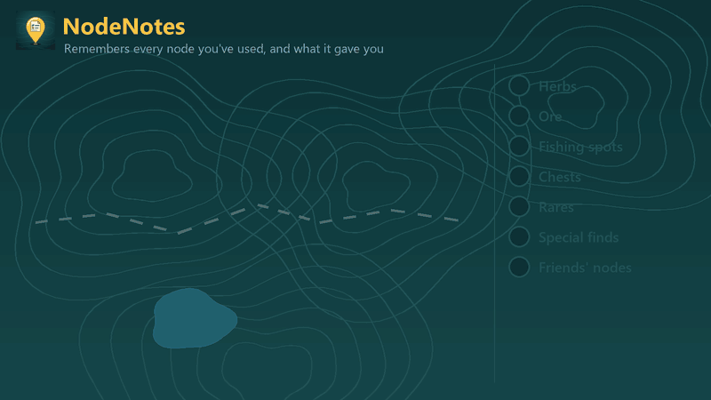
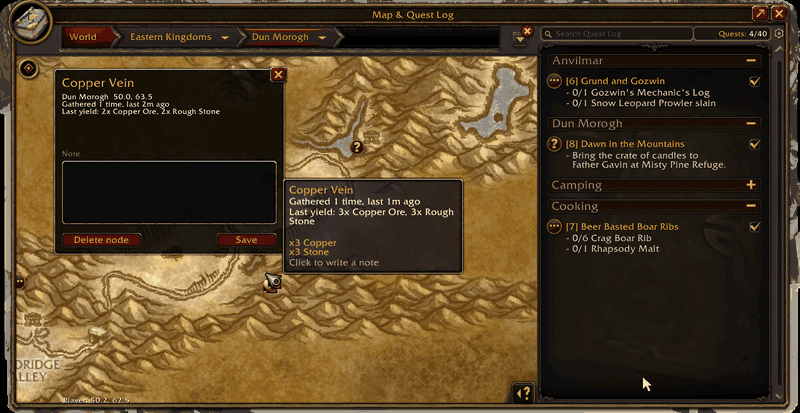

<p align="center"></p>

# NodeNotes

A World of Warcraft: Forever addon that keeps a personal record of the nodes
you have used: herbs, ore, fishing spots, chests, rares and special drops.

When you pick a herb, mine a vein, land a catch, open a chest, meet a rare or
get a blue from a mob, NodeNotes remembers the spot, what it gave you, and
when. Each one shows as a pin on the world map and the minimap. Click a world
map pin to see its history and write yourself a note. Sharing with your group
or guild is optional and off until you turn it on.





## What it records and shows

- **Automatic node log.** Gather a herb, mine a vein, catch a fish or open a
  chest and the spot is recorded.
- **Rares.** Target, hover or see the nameplate of a rare and its spot is
  recorded with a skull pin. Loot it and the kill and its drop are added. The
  pin follows the rare to wherever you last met it.
- **Special finds.** A blue or better from any mob gets its own pin, so you
  remember where that drop came from. `/nn finds green` lowers the bar,
  `/nn finds epic` raises it.
- **Yield history.** Each node remembers what it gave you last time, for
  example `3x Copper Ore, 3x Rough Stone`, plus running totals per item. A
  node that ever gave you a blue or better gets a coloured ring on the world
  map.
- **Last visited.** See how long ago you visited each node.
- **Notes.** Click a world map pin and type whatever helps you: "behind the
  wreck", "watch for the patrol", "low tide only".
- **World map, continent map and minimap pins.** Pins use the icon of what you
  looted. On the world map, a gold corner marks nodes that have a note.
  Continent maps show every zone's nodes at once, a little smaller. Round and
  square minimaps both work.
- **Share with friends, if you want to.** `/nn share group` sends your nodes
  and notes to your party or raid as you record them. Friends running
  NodeNotes keep them apart from their own, with a blue corner on the world
  map and greyed out on the minimap. Off until you turn it on.

Several hits on one mining vein count as a single visit, with the yields
added together. The same goes for fishing: casts from one stretch of shore
within ten minutes are one visit to one spot. Objects that only hold quest
items are not recorded.

## Install

**CurseForge:** install [NodeNotes](https://www.curseforge.com/wow/addons/nodenotes)
from the CurseForge app for World of Warcraft: Forever.

**Manual:** download the latest release zip and extract it so that you end up
with `World of Warcraft/<forever client folder>/Interface/AddOns/NodeNotes/`.
Restart the game and enable NodeNotes on the character select screen.

After an update, restart the game rather than using `/reload`, so the game
loads any new files.

## Recording a node and writing a note

1. Gather a herb, mine a vein, fish, open a chest or find a rare. Chat
   confirms the first time a spot is recorded.
2. Open the world map for that zone. Hover a pin for its history, click it to
   write a note. The note saves when you close the window.
3. Type `/nn` at any time to open the note for the node you visited last.

## Sharing with friends

Sharing is off until you turn it on, and it only goes where you send it.

| Command | What it does |
|---|---|
| `/nn share group` | Send to your party or raid |
| `/nn share guild` | Send to your guild |
| `/nn share both` | Send to both |
| `/nn share sync` | Send every node in your current zone now |
| `/nn share off` | Stop sending |

While sharing is on, each node you record or write a note on is sent as a
hidden addon message. The message holds the node's spot, kind, name, icon,
visit count, how long ago you were last there, best item quality, up to three
items of its last yield, and your note, cut short if it does not fit. For a
rare it also holds the rare's NPC id. About one message goes out a second,
and nothing is sent in combat. Nothing is sent to people outside the channel
you picked, and nothing about you beyond your character name, which the game
attaches to every message.

Nodes your friends share are stored apart from yours and never change your own
history. A friend's node where you already have one is not drawn twice.
Everything received is checked and cleaned before it is stored. Friends'
nodes are shown and stored by default. `/nn friends off` hides them and stops
storing new ones, and `/nn friends clear` deletes them.

## Commands

`/nodenotes` works in place of `/nn` in every command below.

| Command | What it does |
|---|---|
| `/nn` | Open the note for the node you visited last |
| `/nn note <text>` | Set that note from chat |
| `/nn list` | List the nodes recorded in your current zone (up to 20) |
| `/nn status` | Node count by kind, and whether sharing is on |
| `/nn help` | List the commands in chat |
| `/nn pins on\|off` | Show or hide world map pins |
| `/nn minimap on\|off` | Show or hide minimap pins |
| `/nn continent on\|off` | Show zone nodes on continent maps (on by default) |
| `/nn fishing on\|off` | Record fishing spots (on by default) |
| `/nn chests on\|off` | Record chests and other lootable objects (on by default) |
| `/nn rares on\|off` | Record rares you see and kill (on by default) |
| `/nn finds on\|off\|green\|blue\|epic` | Record special mob drops (blue or better by default) |
| `/nn share off\|group\|guild\|both\|sync` | Share your nodes (off by default) |
| `/nn friends on\|off\|clear` | Show, hide or delete friends' nodes (on by default) |
| `/nn debug on\|off` | Keep a short diagnostic log in the saved data |

## What it does not do

- It does not ship a node database or show nodes that neither you nor a
  friend sharing with you has visited.
- It does not predict respawns.
- It does not automate anything. Every record comes from something you, or a
  friend who chose to share, did.

## Known limits

- Herb and mining casts are recognised by spell id and by the game's own name
  for the spell, so any language works. A gathering spell with a different
  name from the usual one is matched by its English name.
- Chests already recorded by 0.3.0 or earlier are kept and shown as chests.
  Chests were off by default before 0.4.0, so upgrading turns them on once.
  `/nn chests off` turns them off again, and that choice is kept.
- Minimap pins show your current zone only, not caves or zones around it.
- A fishing spot is recorded where you stood, not where the bobber landed.
- A rare's pin is placed where you stood when you saw or looted it, not where
  the rare stood.

## Reporting a problem

Open an [issue on GitHub](https://github.com/MrGuato/NodeNotes/issues) with
your game build, what you gathered, and what you expected to see. If you can,
run `/nn debug on`, reproduce the problem, type `/reload`, and attach
`WTF/Account/<account>/SavedVariables/NodeNotes.lua`.

## Development

The addon is plain Lua with no libraries. Every push and pull request runs
[luacheck](https://github.com/lunarmodules/luacheck) and the test harness
through GitHub Actions.

| File | Purpose |
|---|---|
| `Core.lua` | Gather, chest, rare and find detection, node storage, slash commands |
| `Note.lua` | The note window |
| `Map.lua` | World map and continent map pins |
| `Minimap.lua` | Minimap pins |
| `Share.lua` | Optional sharing with your group and guild |
| `tests/harness.lua` | Runs the addon against a stubbed game API |
| `docs/make_demo_gif.py` | Draws `docs/demo.gif` (needs Pillow) |
| `docs/make_screenshot_gif.py` | Animates `docs/map-note.png` into `docs/map-note.gif` (needs Pillow) |

Run the checks locally with Lua 5.1 (or LuaJIT) and luacheck from the
repository root:

```
luacheck .
lua5.1 tests/harness.lua .
```

## License

NodeNotes is licensed under the MIT License. See [LICENSE](LICENSE).
