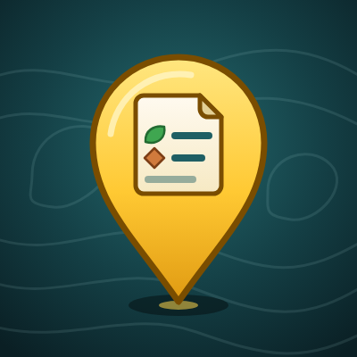
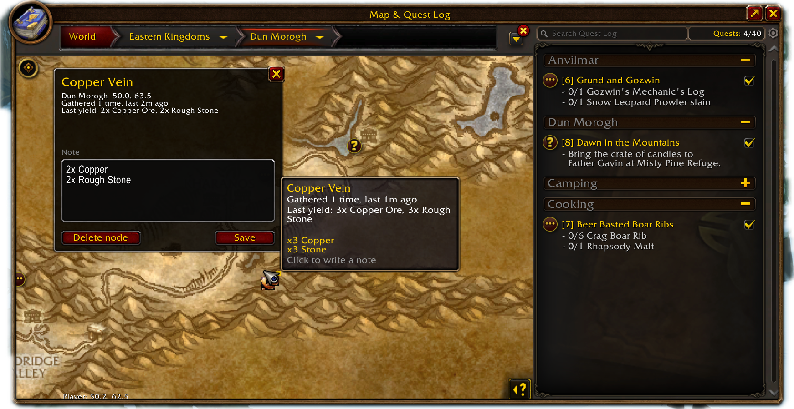

<p align="center"></p>

# NodeNotes

A World of Warcraft: Forever addon that keeps a personal record of the
gathering nodes and fishing spots you have used.

When you pick a herb, mine a vein, or land a catch, NodeNotes remembers the
spot, what it gave you, and when. Each one shows as a pin on the world map and
the minimap. Click a world map pin to see its history and write yourself a
note.



## Features

- **Automatic node log.** Gather a herb, mine a vein, or catch a fish and the
  spot is recorded. Nothing to click.
- **Yield history.** Each node remembers what it gave you last time, for
  example `3x Copper Ore, 3x Rough Stone`, plus running totals per item.
- **Last gathered.** See how long ago you visited each node.
- **Notes.** Click a pin and type whatever helps you: "behind the wreck",
  "watch for the patrol", "low tide only".
- **World map and minimap pins.** Pins use the icon of what you looted. A
  gold corner marks nodes that have a note.
- **Your data only.** Every pin is a node you gathered yourself. Nothing is
  shared, downloaded, or sent to other players.

Several hits on one mining vein count as a single visit, with the yields
added together. The same goes for fishing: casts from one stretch of shore
within ten minutes are one visit to one spot.

## Install

**CurseForge:** install [NodeNotes](https://www.curseforge.com/wow/addons/nodenotes)
from the CurseForge app for World of Warcraft: Forever.

**Manual:** download the latest release zip and extract it so that you end up
with `World of Warcraft/<forever client folder>/Interface/AddOns/NodeNotes/`.
Restart the game and enable NodeNotes on the character select screen.

## Usage

1. Gather a herb, mine a vein, or fish. Chat confirms the first time a spot
   is recorded.
2. Open the world map for that zone. Hover a pin for its history, click it to
   write a note. The note saves when you close the window.
3. Type `/nn` at any time to open the note for the node you gathered last.

## Commands

| Command | What it does |
|---|---|
| `/nn` | Open the note for the node you gathered last |
| `/nn note <text>` | Set that note from chat |
| `/nn list` | List the nodes recorded in your current zone |
| `/nn pins on\|off` | Show or hide world map pins |
| `/nn minimap on\|off` | Show or hide minimap pins |
| `/nn fishing on\|off` | Record fishing spots (on by default) |
| `/nn chests on\|off` | Also record chests and other lootable objects |
| `/nn status` | Node count |
| `/nn debug on\|off` | Keep a short diagnostic log in the saved data |

`/nodenotes` works in place of `/nn`.

## What it does not do

- It does not ship a node database or show nodes you have not visited.
- It does not predict respawns.
- It does not automate anything. Every record comes from a gather you did
  yourself.

## Known limits

- Herb and mining detection matches English spell names.
- World map pins show on the zone map the node was recorded on, not on
  continent maps.
- Minimap pins assume a round minimap.
- A fishing spot is recorded where you stood, not where the bobber landed.

## Reporting a problem

Open an issue with your game build, what you gathered, and what you expected
to see. If you can, run `/nn debug on`, reproduce the problem, type `/reload`,
and attach `WTF/Account/<account>/SavedVariables/NodeNotes.lua`.

## Development

The addon is plain Lua with no libraries. Every push runs
[luacheck](https://github.com/lunarmodules/luacheck) and the test harness
through GitHub Actions.

| File | Purpose |
|---|---|
| `Core.lua` | Gather detection, node storage, slash commands |
| `Note.lua` | The note window |
| `Map.lua` | World map pins |
| `Minimap.lua` | Minimap pins |
| `tests/harness.lua` | Runs the addon against a stubbed game API |

Run the checks locally with Lua 5.1 and luacheck from the repository root:

```
luacheck .
lua5.1 tests/harness.lua .
```

## License

MIT. See [LICENSE](LICENSE).
